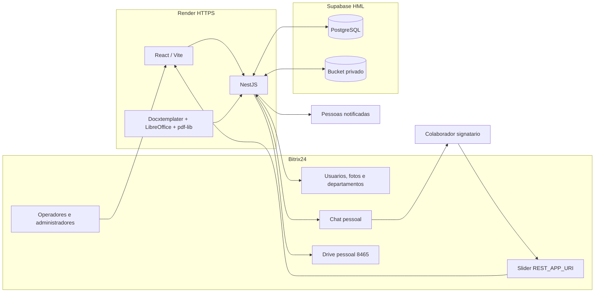
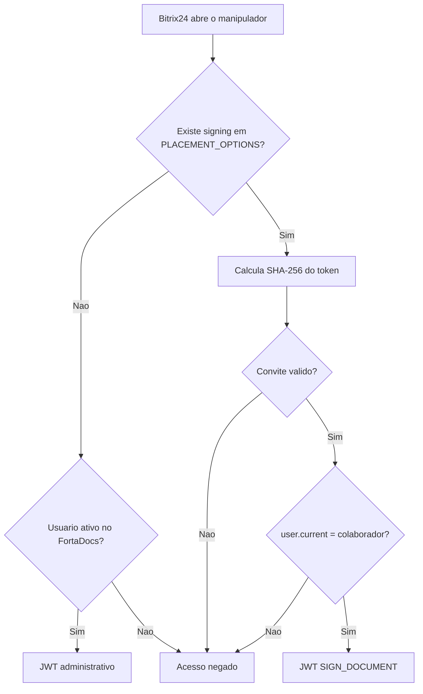

# Arquitetura do FortaDocs

## Visao geral

O FortaDocs e um aplicativo de servidor incorporado ao Bitrix24. O portal fornece identidade,
usuarios, departamentos, fotos e chat. O FortaDocs gera os documentos e executa a assinatura em
uma tela propria aberta dentro do Bitrix24. PostgreSQL e Storage privados ficam no Supabase.

## Componentes

| Componente | Responsabilidade |
|---|---|
| Frontend React | Painel administrativo e experiencia exclusiva do signatario |
| API NestJS | Autorizacao, regras, PDF, convites, chat, notificacoes e auditoria |
| Prisma/PostgreSQL | Dados operacionais, snapshots, convites e trilha de eventos |
| Supabase Storage | DOCX de origem, PDFs sem assinatura e PDFs finais |
| Bitrix24 OAuth | Confirma o usuario atual no painel e no link de assinatura |
| `im.message.add` | Envia o convite ao chat pessoal do colaborador |
| `REST_APP_URI` | Abre o FortaDocs dentro do portal com contexto do convite |
| Drive Bitrix24 | Guarda o PDF final em `Termo de Responsabilidade` e confirma a conclusao |

## Identidades e sessoes

Existem dois contextos isolados:

1. **Administrativo**: o usuario precisa estar ativo em `app_users`. O JWT concede acesso ao
   painel conforme perfil e configuracao de operador.
2. **Signatario**: o usuario nao precisa receber acesso ao painel. O JWT possui
   `scope=SIGN_DOCUMENT`, referencia um unico convite e e aceito somente em `/signing/*`.

O token do convite nao autentica sozinho. O backend tambem consulta `user.current` e exige que o
ID Bitrix24 seja igual ao colaborador do documento.

## Dados principais

| Tabela | Uso |
|---|---|
| `app_users` | Usuarios administrativos autorizados |
| `app_employees` | Snapshot minimo do colaborador |
| `app_send_requests` | Solicitacao, arquivo e status do termo |
| `app_send_request_equipment` | Equipamentos imutaveis do documento |
| `app_send_request_notification_recipients` | Notificados escolhidos para aquele termo |
| `app_signatures` | Estado agregado e hashes do PDF final |
| `app_signing_invitations` | Convite, validade, metodo e evidencia da assinatura |
| `app_signature_events` | Eventos idempotentes de envio, abertura e conclusao |
| `app_bitrix_installations` | OAuth do aplicativo, criptografado |
| `app_bitrix_launch_codes` | Codigos de abertura de uso unico |

## Geracao e assinatura do documento

1. O DOCX versionado recebe nome, CPF, data e equipamentos.
2. O LibreOffice converte o documento para PDF.
3. A API calcula SHA-256, envia o PDF ao bucket privado e retorna uma URL temporaria.
4. No envio, a API cria assinatura `FORTADOCS`, convite e destinatarios de notificacao.
5. O colaborador abre o link no chat e escolhe assinatura digitada, desenhada ou imagem.
6. O frontend normaliza a assinatura para PNG.
7. O backend valida o PNG, incorpora-o na ultima pagina e calcula novos hashes.
8. O convite e encerrado e o documento passa para `SIGNED`; o PDF privado permanece no Supabase.
9. A API localiza o Drive do usuario `8465`, envia o arquivo para `Termo de Responsabilidade` e
   guarda os IDs retornados.
10. Somente depois dessa confirmacao o documento passa para `FINISHED` e a solicitacao para
    `COMPLETED`.

O diagrama detalhado de sequencia, estados e controles esta em
[internal-signing-flow.md](internal-signing-flow.md).

## Seguranca

- segredos somente no backend e no painel do Render;
- tokens OAuth criptografados em repouso;
- tabelas `app_*` com RLS e sem DML para `anon`/`authenticated`;
- bucket privado e URLs assinadas de curta duracao;
- token de convite armazenado apenas como hash;
- codigo de abertura de dois minutos e uso unico;
- sessao do signatario limitada a uma hora;
- checagem de identidade pelo Bitrix24 em cada abertura;
- assinatura limitada a PNG de 1 MB no backend;
- conclusao atomica, SHA-256 e trilha de eventos;
- dados pessoais ausentes de logs de integracao.

## Legado

Registros antigos dos provedores `BITRIX` e `ZAPSIGN` permanecem consultaveis e nao sao apagados.
Novos termos usam `FORTADOCS`. As rotinas antigas ficam isoladas para compatibilidade ate que o
periodo de retencao dos registros historicos termine.
