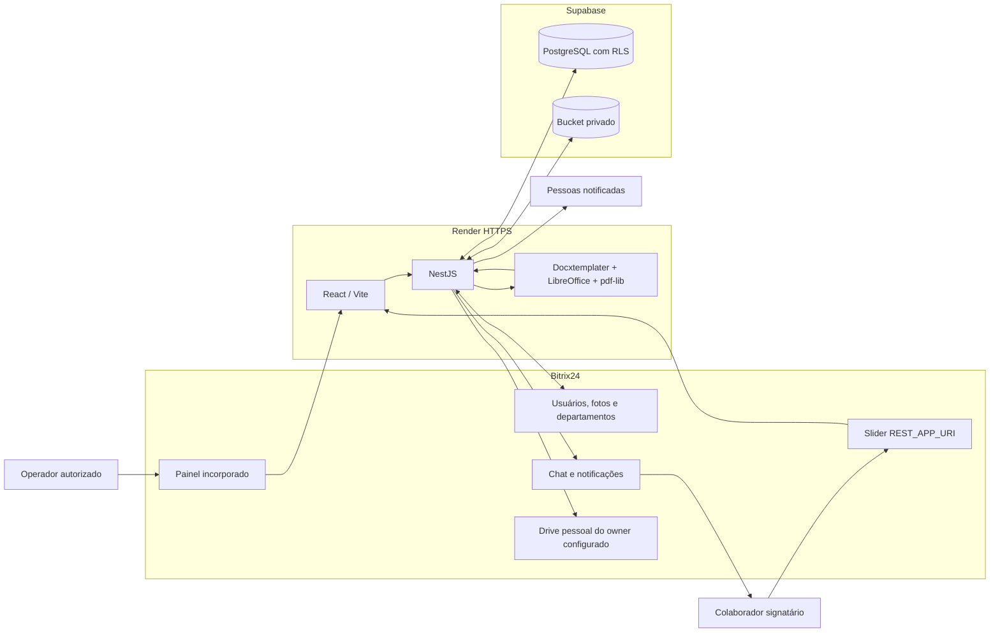
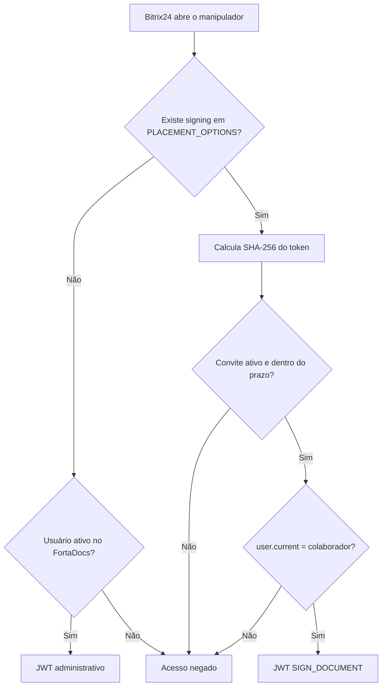

# Arquitetura do FortaDocs

## Visão geral

O FortaDocs é um aplicativo de servidor incorporado ao Bitrix24. O portal fornece identidade,
diretório de usuários, departamentos, fotos, chat e Drive. O FortaDocs gera o documento e oferece
uma tela própria de assinatura aberta dentro do Bitrix24. PostgreSQL e Storage privados ficam no
Supabase; o backend e o frontend público HTTPS são publicados no Render.



## Responsabilidades

| Componente | Responsabilidade |
|---|---|
| Frontend React | Painel administrativo responsivo e experiência isolada do signatário |
| API NestJS | Autorização, regras, PDF, convites, chat, notificações, Drive e auditoria |
| Prisma/PostgreSQL | Dados operacionais, snapshots mínimos, convites e trilha de eventos |
| Supabase Storage | DOCX de origem, PDFs sem assinatura e PDFs finais em bucket privado |
| Bitrix24 OAuth | Confirma o usuário atual no painel e na abertura do convite |
| `im.message.add` | Envia o convite pessoal ao chat do colaborador |
| `REST_APP_URI` | Abre o FortaDocs dentro do portal com o contexto do convite |
| Drive Bitrix24 | Guarda o PDF final na pasta configurada e confirma a conclusão |

Na homologação atual, `BITRIX_DRIVE_OWNER_USER_ID=8465` e
`BITRIX_DRIVE_FOLDER_NAME=Termo de Responsabilidade`. O código usa as variáveis, e não o ID
fixo, para permitir a futura migração a uma conta técnica ou Drive empresarial.

### Envio de até cinco termos

A tela **Envio de termo** mantém até cinco formulários independentes no navegador. O operador alterna
entre eles por abas compactas, gera as prévias e confirma uma única ação de envio. Internamente, cada
termo continua sendo uma `SendRequest`, com colaborador, equipamentos, PDF, assinatura, convite e
auditoria próprios. As chamadas são executadas de forma sequencial para respeitar a fila de conversão
e os limites do Bitrix24; uma falha não interrompe os termos seguintes e a nova tentativa atua somente
nos itens que falharam. O histórico persistido continua sendo a fonte da verdade se uma resposta HTTP
se perder durante o envio.

### Arquivamento idempotente no Drive

O backend procura primeiro o Drive pessoal pelo usuário configurado. Se o filtro do Bitrix24 responder
vazio, faz uma segunda busca paginada antes de declarar indisponibilidade e mantém o resultado em cache
por cinco minutos. `BITRIX_DRIVE_STORAGE_ID` pode fixar opcionalmente o armazenamento depois de sua
identificação. O nome físico do PDF recebe um marcador determinístico da assinatura; antes e depois de
um upload ambíguo, o backend procura esse nome na pasta. Assim, repetir a operação confirma o arquivo
existente em vez de criar uma cópia com sufixo `(1)`.

## Fluxo ponta a ponta

```mermaid
sequenceDiagram
  autonumber
  actor Operador
  participant Web as FortaDocs
  participant API as API NestJS
  participant B24 as Bitrix24
  participant DB as PostgreSQL
  participant Storage as Storage privado
  actor Colaborador
  participant Drive as Drive pessoal

  Operador->>Web: Seleciona colaborador pelo ID
  Web->>API: Dados do termo, CPF e equipamentos
  API->>B24: Consulta perfil e departamento pelo ID
  B24-->>API: Nome, e-mail, cargo, setor e foto
  API->>API: Valida CPF e gera DOCX/PDF
  API->>Storage: Salva PDF sem assinatura + SHA-256
  Storage-->>Web: Prévia por URL temporária
  Operador->>Web: Confirma envio e notificados
  Web->>API: Enviar termo
  API->>DB: Cria assinatura FORTADOCS e convite com token em hash
  API->>B24: Envia link pessoal pelo chat
  API->>DB: Estado ENVIADO
  B24-->>Colaborador: Convite válido por sete dias
  Colaborador->>B24: Abre o link dentro do portal
  B24->>API: OAuth, PLACEMENT_OPTIONS e user.current
  API->>DB: Confere token, prazo e ID; estado VISUALIZADO
  API-->>Colaborador: Tela restrita para digitar, desenhar ou importar
  Colaborador->>API: PNG normalizado + concordância
  API->>Storage: Lê original e salva PDF assinado + SHA-256
  API->>DB: Estado ASSINADO e convite encerrado
  API->>B24: Notifica os destinatários escolhidos
  API->>Drive: Salva na pasta configurada
  alt Drive confirma arquivo
    Drive-->>API: IDs do arquivo, pasta e detalhe
    API->>DB: Estado CONCLUÍDO / ARCHIVED
  else Drive falha
    API->>DB: Mantém ASSINADO / archive_status=FAILED
    API-->>Web: Disponibiliza tentativa de arquivamento
  end
```

## Identidades e sessões

Existem dois contextos isolados:

1. **Administrativo**: o usuário precisa estar ativo em `app_users`. A resposta de sessão informa
   perfil e `user.canOperate`; somente operadores criam, enviam, sincronizam ou removem termos.
2. **Signatário**: o usuário não recebe acesso administrativo. O JWT possui
   `scope=SIGN_DOCUMENT`, referencia um único convite e só é aceito em `/signing/*`.

O token do convite não autentica sozinho. O backend consulta `user.current` e exige que o ID
Bitrix24 seja o mesmo colaborador associado ao documento.



## Dados e crescimento

O schema possui 18 tabelas `app_*`. A solicitação é o agregado central; equipamentos,
destinatários de notificação, tentativas, assinatura e eventos preservam a evidência de cada
termo. Consulte [database.md](database.md) para a relação completa.

A API de histórico oferece paginação por cursor, limite entre 10 e 100 e filtros no servidor. O
índice `(removed_at, created_at, id)` sustenta a ordenação conforme o volume cresce. O diretório
Bitrix24 usa cache curto de 60 segundos e requisições HTTP têm timeout de 15 segundos. A
sincronização processa no máximo 100 assinaturas por execução, com concorrência cinco.

Conversões PDF passam por uma fila local controlada por:

- `PDF_CONVERSION_CONCURRENCY` — padrão `1`, máximo aceito `4`;
- `PDF_CONVERSION_QUEUE_LIMIT` — padrão `20`;
- `PDF_CONVERSION_QUEUE_TIMEOUT_MS` — padrão `30000`.

Esses limites evitam várias instâncias pesadas do LibreOffice no mesmo processo. Eles não
substituem uma fila distribuída quando houver mais de uma réplica.

## Remoção operacional

A tela **Termos** usa caixas de seleção, seleção de todos os itens removíveis carregados e uma
confirmação única. A API aceita até 100 IDs por operação e executa remoção lógica, atômica e
auditada:

- rascunhos deixam a lista sem destruir registros;
- convites pendentes são revogados e a assinatura é cancelada;
- PDFs, hashes e eventos assinados permanecem preservados;
- itens já removidos são ignorados de forma idempotente;
- um termo `SIGNED` com Drive `PENDING` ou `FAILED` é bloqueado até o arquivamento.

## Segurança

- segredos somente no backend e no painel do Render;
- tokens OAuth criptografados em repouso;
- perfil do colaborador derivado novamente no backend pelo ID Bitrix24;
- CPF validado, normalizado e nunca escrito em logs técnicos;
- tabelas `app_*` com RLS e sem DML para `anon`/`authenticated`;
- bucket privado, tipos/tamanho controlados e URLs assinadas de curta duração;
- token do convite armazenado apenas como hash;
- código de abertura de dois minutos e uso único;
- sessão do signatário limitada a uma hora;
- imagem de assinatura PNG limitada por bytes, dimensões e quantidade de pixels;
- conclusão atômica, SHA-256 e trilha de eventos;
- payloads de integração registrados apenas com metadados técnicos, sem documento ou mensagem.

## Escopos Bitrix24

O aplicativo atual usa `basic`, `user`, `user_basic`, `department`, `im`, `placement` e `disk`.
Os escopos `crm` e `sign.b2e` pertencem ao Bitrix Sign B2E legado e não são necessários para
novos termos.

## Legado e próximos passos

Registros antigos dos provedores `BITRIX` (Sign B2E) e `ZAPSIGN` permanecem consultáveis. Novos
termos usam `FORTADOCS`; não há assinatura de representante no documento atual.

Antes de escalar horizontalmente, é necessário externalizar o processamento para outbox/fila,
adotar jobs idempotentes de expiração, notificações e arquivamento, distribuir locks e retirar
migrations do startup da API. Também permanecem pendentes a política formal de retenção,
restauração testada, métricas/alertas e a eliminação do ponto único representado pelo Drive
pessoal configurado.
