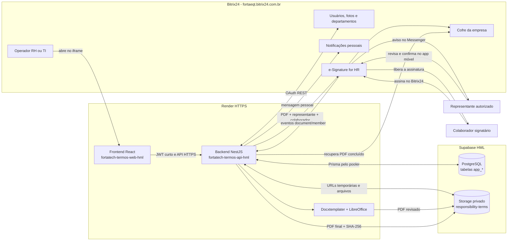
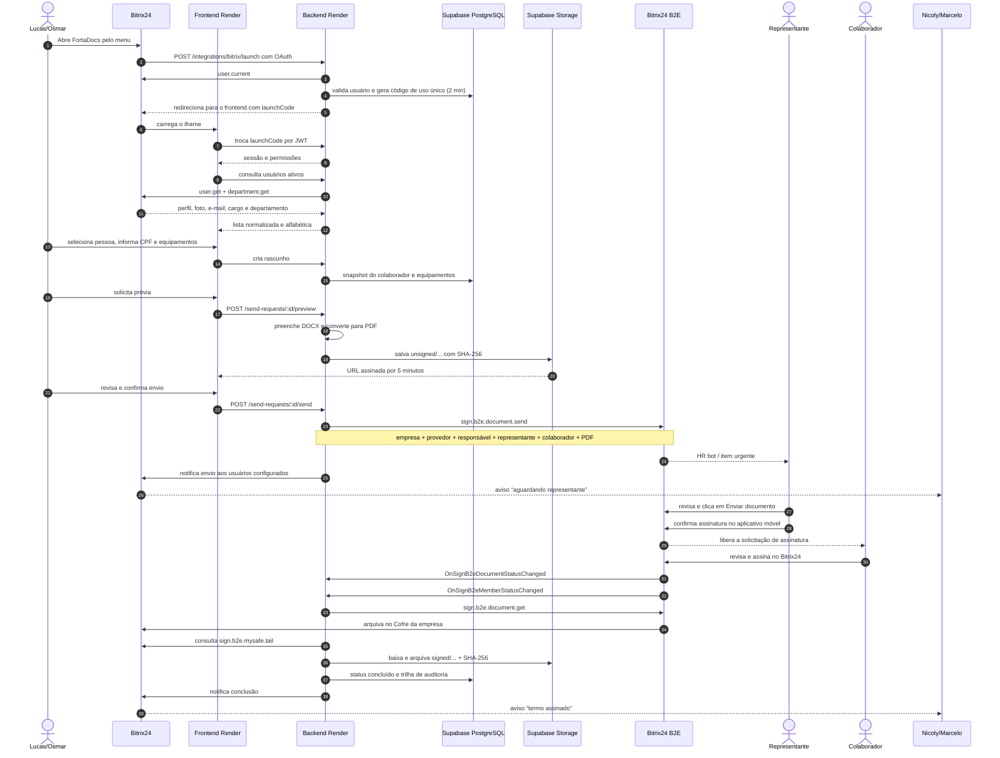
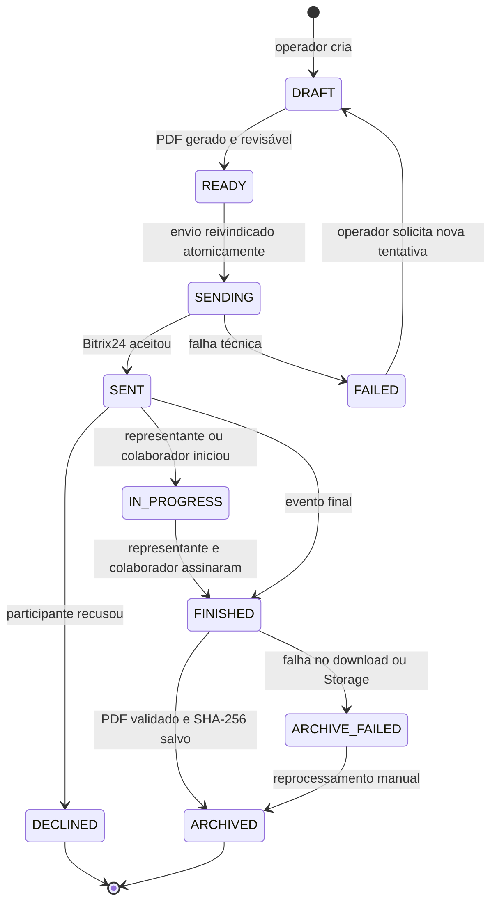

# Arquitetura e fluxo do FortaDocs

## Visão geral

O FortaDocs é uma aplicação web de servidor incorporada ao Bitrix24. O Bitrix24 fornece identidade, cadastro corporativo, notificações, assinatura B2E e o Cofre da empresa; o Supabase guarda os dados e cópias privadas dos arquivos. O backend é a única camada autorizada a acessar segredos e recursos privilegiados.

## Sequência ponta a ponta

## Estados do termo

## Responsabilidades e acesso

| Papel | O que faz | O que não faz |
|---|---|---|
| Administrador | Libera acesso, define perfil, operadores, notificados e templates | Não assina automaticamente pelo colaborador |
| Operador | Cria o rascunho, informa CPF/equipamentos, revisa e envia | Não altera um documento depois do envio |
| Notificado | Recebe avisos de envio e conclusão no Bitrix24 | Não participa da assinatura |
| Representante | Revisa e assina em nome da empresa quando formalmente autorizado | Não pode ter a assinatura inserida automaticamente pelo FortaDocs |
| Colaborador | Recebe a solicitação depois do representante e assina no Bitrix24 | Não acessa o painel interno do FortaDocs |
| Backend | Orquestra OAuth, PDF, assinatura, arquivo e auditoria | Não expõe chaves ao navegador |

Uma pessoa pode acumular perfil administrativo, operação e notificações. **Acessar o FortaDocs**, **Perfil e Setor**, **Gerenciar Termos** e **Receber Notificações** são controles independentes.

## Fronteiras de segurança

- O iframe aceita somente `https://fortaeqt.bitrix24.com.br`.
- O código de abertura é de uso único, armazenado como hash e expira em dois minutos.
- Tokens OAuth do Bitrix24 são cifrados com `BITRIX_TOKEN_ENCRYPTION_KEY`.
- O Bitrix24 recebe o PDF e os identificadores dos participantes por OAuth com escopos `crm` e `sign.b2e`.
- Eventos B2E são validados pelo `application_token` do aplicativo e deduplicados.
- `anon` e `authenticated` não possuem DML nas tabelas `app_*`; o Prisma acessa PostgreSQL no servidor.
- O bucket é privado; URLs de download expiram em cinco minutos.
- O PDF final é validado pelo cabeçalho, limitado em tamanho e registrado com SHA-256.
- CPF, tokens e conteúdo do documento não devem aparecer nos logs.

## Implantação

Cada push na branch `main` aciona o Blueprint do Render. O backend executa `prisma migrate deploy`, seed idempotente e inicia a API. O frontend é compilado com a URL pública da API. A configuração interativa do aplicativo local no Bitrix24 deve apontar para as URLs permanentes descritas no [runbook](homologation-runbook.md).
