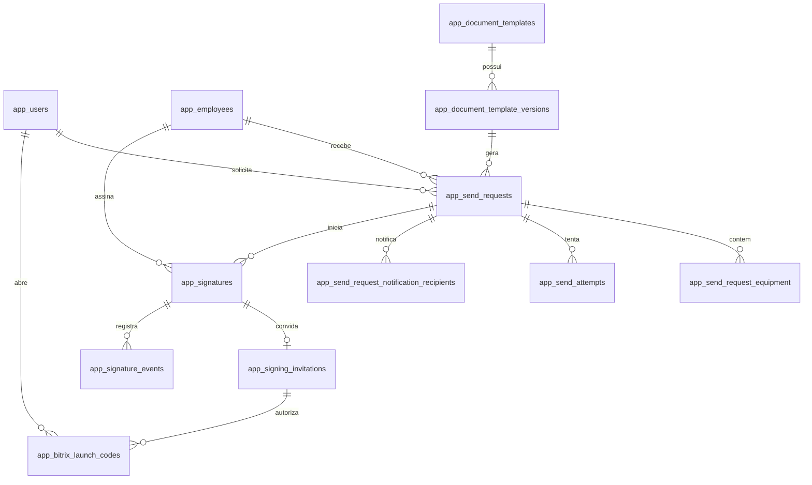

# Banco de dados

O schema funcional fica em `public` e contem 18 tabelas com prefixo `app_`. Os schemas internos do
Supabase nao sao modificados.

## Relacionamentos principais

## Tabelas

| Tabela | Responsabilidade |
|---|---|
| `app_users` | Identidade interna, perfil e estado de acesso |
| `app_term_workflow_participants` | Operadores e selecao inicial de notificacoes |
| `app_employees` | Snapshot minimo do colaborador |
| `app_document_templates` | Tipo logico do documento |
| `app_document_template_versions` | Versoes imutaveis do DOCX |
| `app_send_requests` | Agregado central e PDF sem assinatura |
| `app_send_request_equipment` | Equipamentos imutaveis do termo |
| `app_send_request_notification_recipients` | Notificados escolhidos para aquele termo |
| `app_send_attempts` | Tentativas tecnicas de envio |
| `app_signatures` | Estado, provedor e PDF final |
| `app_signing_invitations` | Convite, validade, metodo e hashes da assinatura |
| `app_signature_events` | Linha do tempo e deduplicacao de avisos |
| `app_webhook_events` | Eventos externos historicos sanitizados |
| `app_bitrix_installations` | Instalacao e OAuth cifrado |
| `app_bitrix_launch_codes` | Codigos de abertura de uso unico |
| `app_integration_logs` | Diagnostico sem segredos ou documentos |
| `app_audit_events` | Auditoria de configuracoes e templates |
| `app_settings` | Configuracoes operacionais nao secretas |

## Regras

- Pessoa, equipamentos e notificados sao preservados por solicitacao.
- Depois do envio, o termo fica bloqueado para edicao.
- Apenas uma tentativa pode reivindicar um termo `READY`.
- O convite possui token unico, salvo somente como SHA-256.
- Um codigo de abertura pertence a um usuario administrativo ou a um convite, nunca aos dois.
- A conclusao do convite e atomica e impede assinatura dupla.
- O PDF final so fica `ARCHIVED` depois do upload privado e do SHA-256.
- RLS esta habilitado em todas as tabelas `app_*`.
- `anon` e `authenticated` nao possuem DML nas tabelas internas.

## Migrations

- Migrations aplicadas nunca sao editadas.
- `DIRECT_URL` e usada em `prisma migrate deploy`.
- `DATABASE_URL` com pooler e usada no runtime.
- `prisma migrate reset` e proibido no projeto remoto.
- Alteracao destrutiva exige backup, auditoria e janela controlada.

A migration `20260723170000_internal_bitrix_signing` e aditiva e preserva todos os registros
historicos dos provedores Bitrix B2E e ZapSign.
