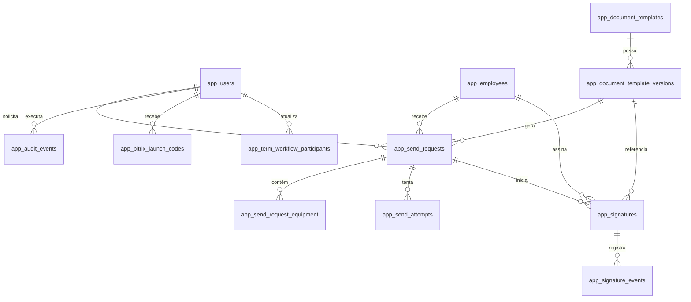

# Banco de dados

O schema funcional fica em `public` e contém 16 tabelas com prefixo `app_`. Os schemas internos do Supabase não são modificados.

## Relacionamentos principais

## Tabelas

| Tabela | Responsabilidade |
|---|---|
| `app_users` | Identidade interna vinculada ao ID Bitrix, perfil e estado de acesso |
| `app_term_workflow_participants` | Operadores e destinatários de notificações editáveis |
| `app_employees` | Snapshot mínimo do colaborador usado nos termos |
| `app_document_templates` | Tipo lógico do documento |
| `app_document_template_versions` | Versões imutáveis do DOCX e hash da origem |
| `app_send_requests` | Agregado central do termo, estado e PDF não assinado |
| `app_send_request_equipment` | Equipamentos imutáveis do termo |
| `app_send_attempts` | Tentativas técnicas de envio ao provedor |
| `app_signatures` | Estado normalizado da assinatura e do arquivamento |
| `app_signature_events` | Linha do tempo e deduplicação de avisos |
| `app_webhook_events` | Eventos externos sanitizados e idempotentes |
| `app_bitrix_installations` | Instalação e tokens OAuth cifrados |
| `app_bitrix_launch_codes` | Códigos de login de uso único e curta duração |
| `app_integration_logs` | Diagnóstico técnico sem CPF, documento ou tokens |
| `app_audit_events` | Auditoria de configurações e templates |
| `app_settings` | Configurações operacionais não secretas |

Estruturas antigas de lote, senha local, empresa, convite e participantes duplicados foram removidas pela migration `20260722153000_remove_redundant_fields`.

## Regras

- O snapshot de pessoa e equipamentos preserva o conteúdo usado no momento do envio.
- Depois de enviado, o termo fica bloqueado para edição.
- Apenas uma tentativa pode reivindicar um termo `READY`; a atualização atômica impede envio duplo.
- O token externo da assinatura é único e o evento externo possui chave idempotente.
- O PDF concluído só fica `ARCHIVED` depois de upload privado e cálculo de SHA-256.
- RLS está habilitado em todas as tabelas `app_*` e `anon`/`authenticated` não possuem DML.

## Migrations

- Migrations já aplicadas nunca são editadas; toda mudança recebe uma nova pasta versionada.
- `DIRECT_URL` é usada para `prisma migrate deploy`.
- `DATABASE_URL` com pooler é usada no runtime.
- `prisma migrate reset` é proibido no projeto remoto.
- Exclusão ou alteração destrutiva exige auditoria de dados, backup e janela controlada.
