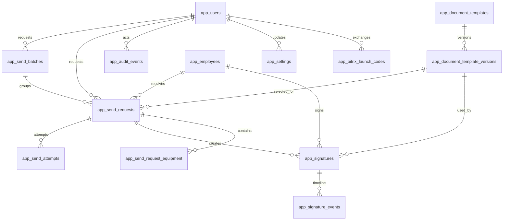

# Banco de Dados

O banco da aplicacao fica no schema `public` do Supabase e usa tabelas fisicas com prefixo `app_`. Os schemas internos do Supabase nao devem ser alterados.

## ERD

## Tabelas

- `app_users`: usuarios internos RH/TI/Admin e autenticacao JWT propria.
- `app_employees`: colaboradores sincronizados do Bitrix24 ou cadastrados manualmente.
- `app_document_templates`: documento logico, como Termo de Responsabilidade.
- `app_document_template_versions`: versoes do documento e ID do template no Bitrix24.
- `app_send_batches`: agrupador opcional para envios manuais em lote.
- `app_send_requests`: centro do fluxo; registra quem recebe, qual modelo e quando enviar.
- `app_send_attempts`: tentativas tecnicas de envio ao Bitrix24.
- `app_signatures`: acompanhamento normalizado da assinatura oficial no Bitrix24.
- `app_signature_events`: linha do tempo de eventos de assinatura.
- `app_webhook_events`: payload bruto recebido do Bitrix24.
- `app_integration_logs`: logs tecnicos de integracao.
- `app_audit_events`: auditoria administrativa.
- `app_settings`: configuracoes operacionais nao sensiveis.
- `app_send_request_equipment`: snapshot imutavel dos equipamentos de cada termo.
- `app_bitrix_installations`: instalacao, endpoints e tokens OAuth cifrados.
- `app_bitrix_launch_codes`: codigos de inicializacao de uso unico.

## Enums

- `app_user_role`: `ADMIN`, `RH`, `TI`.
- `app_employee_status`: `ACTIVE`, `INACTIVE`, `PENDING`.
- `app_invitation_status`: `UNKNOWN`, `INVITED`, `ACCEPTED`.
- `app_send_batch_type`: `MANUAL`, `AUTOMATIC`.
- `app_send_trigger_type`: `BITRIX_INVITE_ACCEPTED`, `MANUAL`, `RETRY`.
- `app_send_request_status`: inclui `DRAFT`, `READY`, `SENT`, `IN_PROGRESS`, `DECLINED`, `FAILED` e estados legados.
- `app_send_attempt_status`: `SENDING`, `SUCCESS`, `FAILED`.
- `app_signature_status`: `PENDING`, `SENT`, `VIEWED`, `IN_PROGRESS`, `SIGNED`, `FINISHED`, `DECLINED`, `ERROR`, `CANCELED`.
- `app_archive_status`: `NOT_REQUIRED`, `PENDING`, `ARCHIVED`, `FAILED`.
- `app_webhook_processing_status`: `RECEIVED`, `PROCESSED`, `FAILED`, `IGNORED`.

## Regras importantes

- Toda assinatura oficial permanece no Bitrix24.
- `app_send_requests` deve existir antes de uma assinatura iniciada pelo sistema.
- `app_signatures.bitrix_stage` guarda o estagio real do Bitrix24.
- `app_signature_events` e `app_webhook_events` sao trilha de auditoria.
- RLS fica habilitado nas tabelas `app_*`; o acesso da aplicacao passa pelo backend.
- `anon` e `authenticated` nao recebem privilegios nas tabelas internas.

## Politica de migrations

- Como o Supabase estava vazio, a migration inicial cria todo o schema de aplicacao.
- Depois de aplicada em ambiente remoto, uma migration existente nao deve ser editada.
- Mudancas futuras devem ser novas migrations.
- Reset destrutivo em Supabase remoto exige backup e aprovacao explicita.
