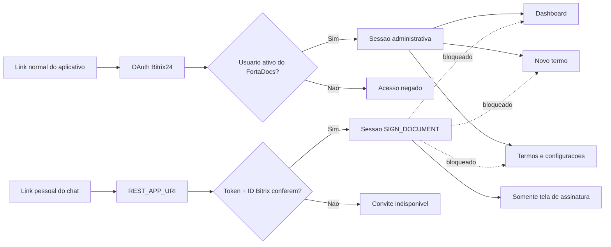
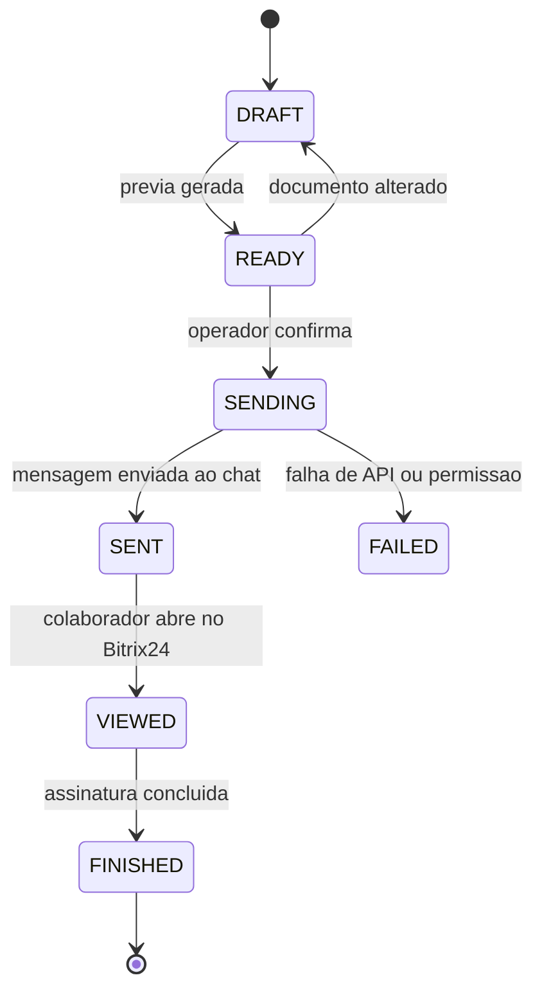

# Diagrama do fluxo de assinatura

## Fluxo principal

```mermaid
sequenceDiagram
    autonumber
    actor Operador
    participant Web as FortaDocs Admin
    participant API as API FortaDocs
    participant DB as PostgreSQL / Supabase
    participant Storage as Storage privado
    participant Chat as Chat Bitrix24
    actor Colaborador
    participant Sign as Tela de assinatura

    Operador->>Web: Seleciona colaborador, equipamentos e notificados
    Web->>API: Cria rascunho e solicita previa
    API->>Storage: Grava PDF sem assinatura
    Storage-->>API: Caminho privado e SHA-256
    API-->>Web: URL temporaria da previa
    Operador->>Web: Confirma envio
    Web->>API: POST /send-requests/:id/send
    API->>DB: Cria assinatura FORTADOCS e convite
    Note over API,DB: Token aleatorio; banco recebe somente o hash
    API->>Chat: im.message.add com link REST_APP_URI
    Chat-->>Colaborador: Mensagem pessoal
    API->>Chat: im.notify.personal.add
    Chat-->>Colaborador: Alerta clicavel
    API->>DB: Registra mensagem, status SENT e evento
    API-->>Web: Envio concluido
    Note over Web,Colaborador: Se operador = colaborador, o Web exibe Abrir minha assinatura

    Colaborador->>Chat: Clica em Abrir e assinar
    Chat->>API: POST launch + OAuth + PLACEMENT_OPTIONS
    API->>Chat: user.current
    Chat-->>API: ID do usuario conectado
    API->>DB: Confere token, prazo, usuario e documento
    API-->>Sign: Codigo de abertura de uso unico
    Sign->>API: Troca codigo por sessao SIGN_DOCUMENT
    API-->>Sign: PDF temporario e dados minimos
    Colaborador->>Sign: Digita, desenha ou importa imagem
    Colaborador->>Sign: Confirma leitura e finaliza
    Sign->>API: PNG normalizado + metodo + concordancia
    API->>Storage: Le PDF original
    API->>API: Incorpora assinatura e calcula hashes
    API->>Storage: Grava PDF assinado
    API->>DB: Conclui convite, assinatura e auditoria
    API->>Chat: Notifica todas as pessoas selecionadas
    API-->>Sign: Confirmacao e link temporario do PDF final
```

## Separacao de acesso



## Estados do documento



## Controles de seguranca

- convite com 256 bits de entropia e validade de sete dias;
- token persistido somente como SHA-256;
- codigo de abertura de uso unico e validade de dois minutos;
- sessao do signatario limitada a uma hora e a endpoints exclusivos;
- validacao do ID atual por `user.current`;
- RLS nas tabelas novas e nenhum privilegio para `anon` ou `authenticated`;
- bucket privado e URLs temporarias;
- limite de 1 MB e validacao de assinatura PNG;
- operacao de conclusao atomica para impedir assinatura dupla;
- SHA-256 do desenho e do PDF final na trilha de auditoria.
