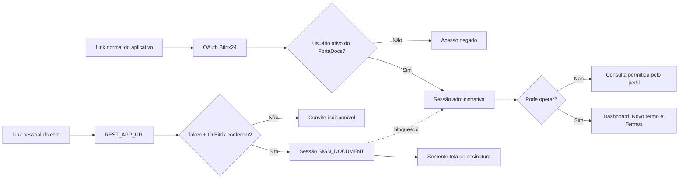
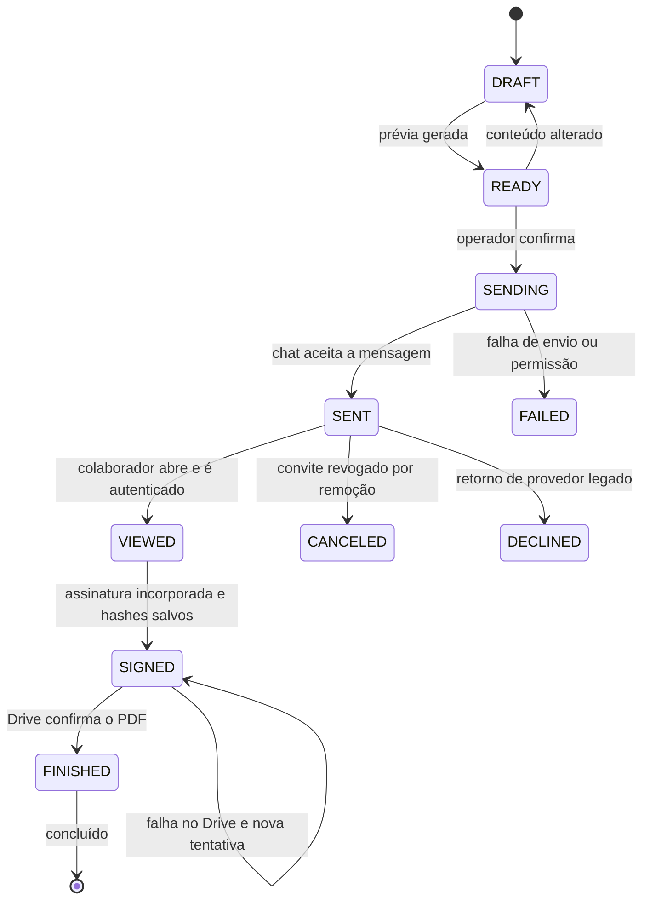

# Fluxo de assinatura interna

## Fluxo principal

```mermaid
sequenceDiagram
    autonumber
    actor Operador
    participant Web as FortaDocs Admin
    participant API as API FortaDocs
    participant Directory as Diretório Bitrix24
    participant DB as PostgreSQL
    participant Storage as Storage privado
    participant Chat as Chat Bitrix24
    actor Colaborador
    participant Sign as Tela de assinatura
    participant Drive as Drive Bitrix24
    actor Notificados

    Operador->>Web: Seleciona colaborador pelo ID, equipamentos e notificados
    Web->>API: Cria ou atualiza rascunho
    API->>Directory: Consulta perfil e departamento pelo ID
    Directory-->>API: Dados atuais do colaborador
    API->>API: Valida e normaliza CPF
    Operador->>Web: Solicita prévia
    Web->>API: POST /send-requests/:id/preview
    API->>Storage: Grava PDF sem assinatura
    Storage-->>API: Caminho privado e SHA-256
    API-->>Web: URL temporária da prévia
    Operador->>Web: Confirma envio
    Web->>API: POST /send-requests/:id/send
    API->>DB: Cria assinatura FORTADOCS e convite
    Note over API,DB: Token aleatório; banco recebe somente o hash
    API->>Chat: im.message.add com link REST_APP_URI
    Chat-->>Colaborador: Mensagem pessoal
    API->>Chat: im.notify.personal.add
    Chat-->>Colaborador: Alerta clicável
    API->>DB: Registra evento e estado SENT
    API-->>Web: Termo Enviado

    Colaborador->>Chat: Clica em Revisar e assinar
    Chat->>API: OAuth + PLACEMENT_OPTIONS
    API->>Directory: user.current
    Directory-->>API: ID do usuário conectado
    API->>DB: Confere token, prazo, usuário e documento
    API->>DB: Marca VIEWED na primeira abertura autenticada
    API-->>Sign: Código de abertura de uso único
    Sign->>API: Troca código por sessão SIGN_DOCUMENT
    API-->>Sign: PDF temporário e dados mínimos
    Colaborador->>Sign: Digita, desenha ou importa imagem
    Colaborador->>Sign: Confirma leitura e finaliza
    Sign->>API: PNG normalizado + método + concordância
    API->>Storage: Lê PDF original e grava o assinado
    API->>DB: Salva hashes, encerra convite e marca SIGNED
    API->>Chat: Notifica destinatários configurados
    Chat-->>Notificados: Termo assinado
    API->>Drive: Salva PDF na pasta configurada
    alt Arquivamento confirmado
        Drive-->>API: IDs do arquivo e da pasta
        API->>DB: Marca FINISHED / COMPLETED / ARCHIVED
        API-->>Sign: Confirma Concluído e libera PDF final
    else Falha no Drive
        API->>DB: Mantém SIGNED e marca archive_status=FAILED
        API-->>Web: Operador pode tentar arquivar novamente
    end
```

Somente o colaborador associado ao termo assina. Operadores, administradores e destinatários de
notificações não acrescentam assinatura ao PDF.

## Separação de acesso



## Máquina de estados



## Status mostrados ao usuário

| Status exibido | Estado técnico e condição |
|---|---|
| **Enviado** | `SENT`: o chat do Bitrix24 aceitou a mensagem com o convite |
| **Visualizado** | `VIEWED`: o colaborador abriu o convite e teve a identidade confirmada |
| **Assinado** | `SIGNED`: a assinatura foi incorporada, o SHA-256 foi salvo e o convite encerrado |
| **Concluído** | `FINISHED` + `COMPLETED` + `ARCHIVED`: o Drive confirmou o PDF na pasta configurada |

Falha de envio usa `FAILED`; `DECLINED` pertence aos provedores legados; cancelamento por remoção
usa `CANCELED`; e falha de processamento da assinatura usa `ERROR`. Um convite expirado tem o
acesso bloqueado por `expires_at`, mas ainda precisa de um job de reconciliação para alterar
automaticamente o estado agregado. Uma falha exclusiva do Drive não desfaz a
assinatura: o termo continua `SIGNED`, recebe `archive_status=FAILED` e pode ser arquivado
novamente por um operador.

## Controles de segurança

- convite com 256 bits de entropia e validade de sete dias;
- token persistido somente como SHA-256;
- código de abertura de uso único e validade de dois minutos;
- sessão do signatário limitada a uma hora e a endpoints exclusivos;
- validação do ID atual por `user.current`;
- perfil do colaborador reconsultado no backend, sem confiar em nome/e-mail enviados pela tela;
- CPF com validação de dígitos, normalização e ausência em logs;
- RLS em todas as 18 tabelas `app_*` e nenhum DML para `anon` ou `authenticated`;
- bucket privado e URLs temporárias;
- imagem limitada a 1 MB, PNG validado, até 4096×2048 e quatro milhões de pixels;
- operação de conclusão atômica para impedir assinatura dupla;
- convite concluído não aceita outra assinatura;
- assinatura posicionada pela linha real do PDF, sem coordenada fixa;
- SHA-256 da imagem e do PDF final na trilha de auditoria.

## Remoção do histórico

A tela **Termos** substitui ações destrutivas individuais por caixas de seleção, seleção de todos
os itens removíveis carregados e uma confirmação em lote. A operação:

- aceita no máximo 100 IDs, remove duplicados e usa uma transação serializável;
- faz remoção lógica por `removed_at`/`removed_by_user_id`;
- revoga convites pendentes somente se ainda não tiverem sido assinados;
- preserva PDFs, hashes, eventos e auditoria;
- ignora itens ausentes ou já removidos, permitindo repetição segura;
- bloqueia qualquer `SIGNED` cujo arquivamento no Drive esteja `PENDING` ou `FAILED`;
- registra um `batchId` comum para a auditoria de todos os itens.

O endpoint `DELETE /send-requests/:id` permanece apenas para compatibilidade e delega à mesma
regra segura.

## Limites operacionais atuais

- histórico com cursor e páginas de 10 a 100 registros;
- cache de usuários/departamentos Bitrix24 por 60 segundos;
- timeout HTTP Bitrix24 de 15 segundos;
- sincronização limitada a 100 assinaturas por execução e concorrência cinco;
- fila local de conversão PDF, por padrão com uma conversão ativa e até 20 aguardando.

Para múltiplas réplicas, essas filas e locks em memória deverão migrar para um mecanismo
distribuído.
